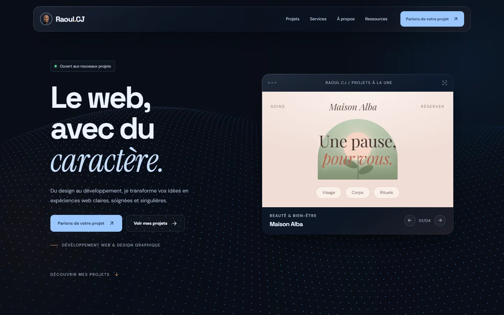

<h1 align="center">Raoul.CJ — Portfolio</h1>

<p align="center">
  Portfolio, services et ressources numériques de <b>Raoul</b>, développeur web & designer graphique.<br />
  <a href="https://raoul29cj.github.io"><b>🌐 Voir le site en ligne</b></a>
</p>

<p align="center">
  
  
  
  
</p>

<p align="center">
  <a href="https://raoul29cj.github.io"></a>
</p>

## ✨ Points forts

- **Fond 3D interactif en WebGL natif** (~5 Ko, sans librairie) : un relief de particules qui se soulève sous le curseur, une onde de choc au clic, une caméra qui tourne au défilement. Repli en canvas 2D si WebGL est indisponible.
- **4 concepts de sites aux identités distinctes** — beauté (Maison Alba), restauration (Sola), barbier (Atelier N°7), menuiserie (Atelier Noyer) — chacun avec sa typographie, sa palette, sa page et son étude de cas.
- **Pages pré-rendues** au build pour le référencement : balises Open Graph, données structurées (services, FAQ, fil d’Ariane), sitemap et robots.txt générés automatiquement.
- **Interface en verre dépoli**, palette par rôles, typographie harmonisée, menu qui suit la section en cours.
- **Accessibilité** : navigation au clavier, respect de « réduire les animations », textes alternatifs, tailles minimales.
- **Sécurité** : politique CSP stricte, validation des liens externes, formulaires protégés contre le spam.
- **Responsive** du mobile au grand écran.

## 📊 Audit Lighthouse (site en ligne)

| | Performance | Accessibilité | Bonnes pratiques |
|---|:---:|:---:|:---:|
| Ordinateur | 100 | 98 | 100 |
| Mobile | 85 | 98 | 100 |

## 🧰 Technologies

React 19 · Vite 7 · Motion · WebGL · CSS moderne (unités de conteneur, `backdrop-filter`) · Formspree · GitHub Actions + GitHub Pages

## 🚀 Lancer le projet

Pré-requis : Node.js 20.19+ ou 22.12+.

```bash
npm install
npm run dev        # http://localhost:5173
npm run dev:lan    # accessible depuis un téléphone sur le même Wi-Fi
npm run build      # génère dist/ (pages pré-rendues, robots.txt, sitemap)
npm run preview    # teste la version de production
```

Chaque envoi sur `main` publie automatiquement le site sur GitHub Pages ([workflow](.github/workflows/deploy.yml)).

## 🗂️ Structure

| Fichier | Rôle |
|---|---|
| `src/config.js` | Contenu : identité, contact, réseaux, services, ebooks, FAQ, parcours, mentions légales |
| `src/projects.js` | Projets du portfolio, démonstrations et études de cas |
| `src/main.jsx` | Page d’accueil, sections, menu et routage |
| `src/Pages.jsx` | Pages projet, pages légales, 404 |
| `src/Background3D.jsx` | Fond 3D WebGL interactif |
| `src/Effects.jsx` | Animations, visuels des 4 concepts |
| `src/Contact.jsx` · `src/Socials.jsx` | Formulaire de contact, liens vers les réseaux |
| `src/styles.css` | Design complet (palette par rôles en tête de fichier) |
| `scripts/seo.mjs` | Pré-rendu HTML, SEO, sécurité, sitemap |

## 📬 Contact

[LinkedIn](https://www.linkedin.com/in/jean-raoul-chocolat-1b3778350/) · [Instagram](https://www.instagram.com/raoul_cj/) · [Le formulaire du site](https://raoul29cj.github.io/#contact)

> Les projets présentés sont des **concepts** réalisés pour le portfolio, signalés comme tels sur le site.
